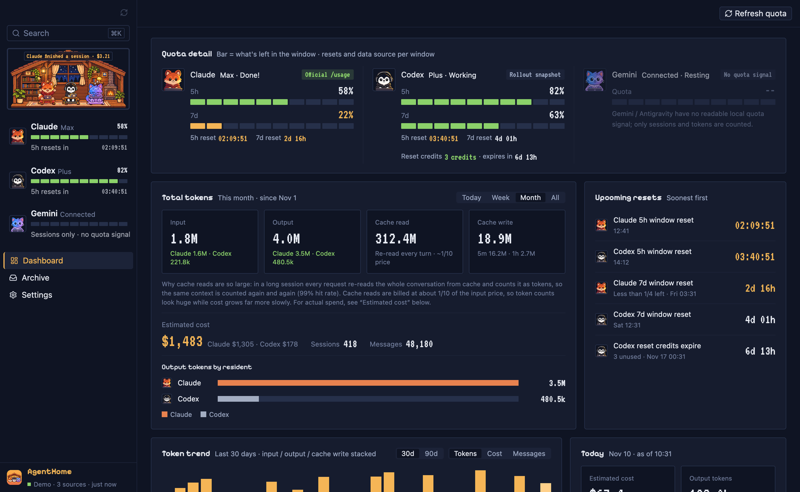
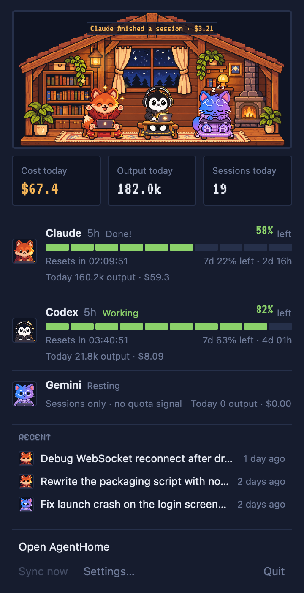
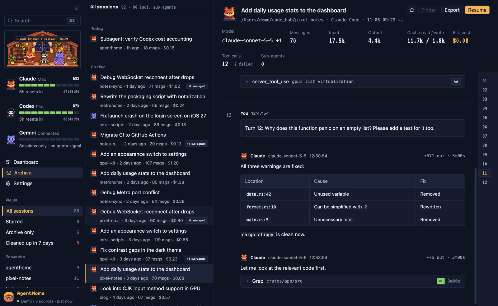
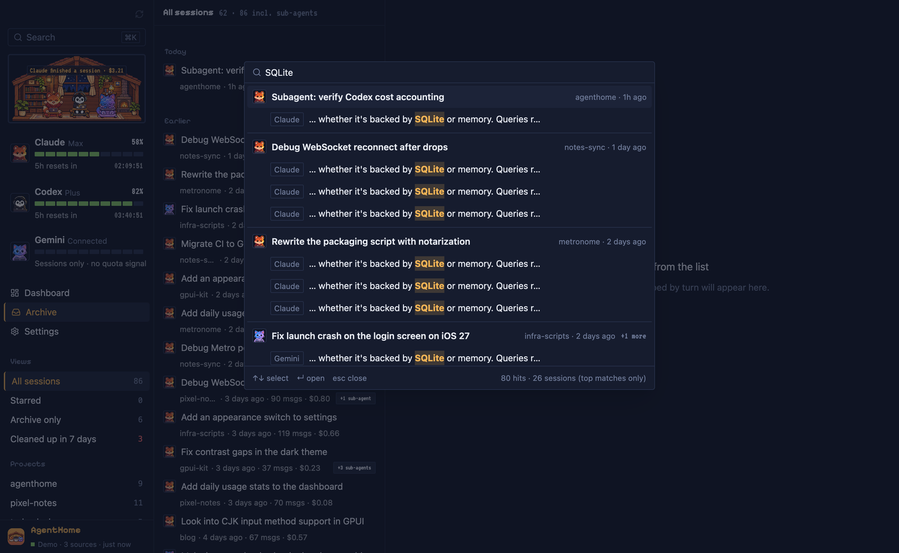

# AgentHome

English | [简体中文](README.zh-CN.md)

A local home for your AI coding agents. AgentHome keeps a permanent, searchable archive of your Claude Code, Codex and Gemini sessions, and puts token usage, estimated cost and remaining subscription quota on one dashboard.

Native macOS app written in Rust with [GPUI Kit](https://github.com/longbridge/gpui-kit). Everything stays on your machine.



> The interface is available in English and Simplified Chinese. All screenshots use built-in demo data.

## Why

- **Agents delete your history.** Claude Code removes session transcripts after 30 days by default. The conversation where you solved a hard problem three months ago is simply gone.
- **The token bill is hard to read.** Long sessions re-read the whole context from cache on every request, so raw token counts look enormous and do not map to cost in an obvious way. Prices differ by model, by cache tier and by context length.
- **Quota is scattered.** Claude's 5-hour and 7-day windows, Codex's 5-hour and weekly windows, Codex credits and their expiry all live in different places.

AgentHome copies every transcript into an archive you own, indexes it for full-text search, and computes usage and cost from the transcripts themselves.

## Menu bar

AgentHome lives in the macOS menu bar. Click the pixel-house icon for a usage summary without opening the main window:



- the habitat, and today's cost, output tokens and sessions;
- one row per agent (Claude, Codex, Gemini): status, how much of the 5-hour window is left as a 10-cell bar, the countdown to its reset, the tightest other window, and today's output and cost;
- the three most recent sessions; clicking one opens it in the main window;
- **Open AgentHome**, **Sync now**, **Settings…** and **Quit**.

Closing the main window only hides it. AgentHome keeps syncing and reading quota in the menu bar; reopen the window from the popup or the Dock icon, and quit with ⌘Q, from the popup or from the Dock menu.

Not implemented yet: a global shortcut for the popup, an icon that changes color when quota runs low, and reset reminders.

<br clear="right">

## Features

- **Archive that outlives agent cleanup.** Each transcript is copied byte-for-byte (zstd-compressed) into `~/AgentHome/raw/` before it is indexed. When the agent deletes its own file, your copy remains.
- **Three sources.** Claude Code, Codex (including archived sessions), and Gemini CLI. For Antigravity, only titles, times and workspaces are indexed; message bodies are encrypted and cannot be read.
- **Real-time sync.** File-system events trigger incremental ingestion by byte offset, so appending a line to a large session costs about half a millisecond. A full scan runs hourly as a safety net.
- **Dashboard.** Quota for each agent, cumulative tokens (input / output / cache read / cache write), estimated cost, 30/90-day trends, today's numbers, breakdown by model and by project, upcoming resets and expirations, archive health.
- **Archive browser.** Sessions grouped by day, sub-agents folded under their parent, per-session cost, a session view with turns, collapsible trace rows for tool calls, Markdown and code highlighting.
- **⌘K global search.** Full-text search across all messages, including Chinese substrings. Results are grouped by session with highlighted matches; Enter jumps to the exact message.
- **Session actions.** Reveal the original file in Finder, export to Markdown, or copy the command to resume the session in its original agent.
- **Menu bar popup.** Quota, today's numbers and recent sessions one click away; the app keeps running there when the window is closed.
- **English and Chinese.** Settings → Language: System, 简体中文 or English. Switching applies immediately.
- **Pixel habitat.** A small pixel-art house in the sidebar where Claude (fox), Codex (penguin) and Gemini (cat) work, think, celebrate, get tired or sleep based on real activity and quota.
- **CLI.** The same data from the terminal: `agenthome scan / sessions / show / stats / quota / activity / statusline`.

See [docs/features.md](docs/features.md) for a page-by-page walkthrough.

| Session detail | ⌘K search |
|---|---|
|  |  |

## Install

Requirements: macOS 15 or later on Apple Silicon (arm64).

1. Download `AgentHome-<version>-macos-arm64.zip` from [the latest release](https://github.com/PeterChen1997/agenthome/releases/latest).
2. Unzip it and move `AgentHome.app` to `/Applications`.
3. Open it. The app is signed with a Developer ID and notarized by Apple, so it opens without Gatekeeper warnings.

On first launch AgentHome creates `~/AgentHome/` and scans the source directories it finds. Nothing needs to be configured. The interface follows the macOS language (Chinese if it is your first preferred language, English otherwise); change it under Settings → Language.

AgentHome adds an icon to the menu bar. Closing the main window keeps the app running there; quit with ⌘Q.

The CLI ships inside the app bundle at `AgentHome.app/Contents/MacOS/agenthome`. You can symlink it onto your `PATH`, or build it from source (see below).

## Privacy and compliance

- **Read-only toward agents.** AgentHome reads the agents' session directories and never modifies, moves or symlinks anything inside them. It copies; it does not link.
- **No credentials.** It does not read API keys, OAuth tokens, credential files or the macOS Keychain.
- **No private endpoints.** It does not call the Claude OAuth usage endpoint or Codex's private usage endpoint.
- **No telemetry, no upload.** There is no analytics and no cloud sync. Your session data never leaves your machine.
- **How quota is read.**
  - Claude: every 15 minutes AgentHome runs the official `claude` CLI's `/usage` command in a background pseudo-terminal and reads the text it prints. This sends no conversation and consumes no tokens. It requires the `claude` CLI to be installed and logged in.
  - Codex: read from the `rate_limits` snapshot that Codex itself writes into its rollout files.
  - Gemini: there is no local quota signal, so only sessions and tokens are shown.

Your archive contains your full conversation history, which may include secrets you once pasted into an agent. Protect `~/AgentHome/` like any other sensitive directory. See [SECURITY.md](SECURITY.md) for details and for reporting vulnerabilities.

## How costs are calculated

Cost is an estimate of the equivalent API price, not what a subscription actually charges you.

- Token usage is read per request from the transcripts and priced with a bundled snapshot of the [LiteLLM](https://github.com/BerriAI/litellm) price table (snapshot of 2026-11-09).
- Cache reads, 5-minute cache writes and 1-hour cache writes are priced separately. Long-context tiers (for example above 272k tokens for some OpenAI models) apply per request.
- Claude sessions that were forked or resumed copy earlier messages into a new file; those duplicates are counted once, by message id.
- Unknown models are marked as unpriced rather than counted as zero.
- When the bundled price table changes, stored costs are recalculated automatically.

Cross-checked against [ccusage](https://github.com/ryoppippi/ccusage), the totals differ by about 1%. The full audit (written in Chinese) is in [docs/12-成本口径核对.md](docs/12-成本口径核对.md).

## Data layout

Everything AgentHome writes lives under `~/AgentHome/`:

| Path | Contents |
|---|---|
| `raw/<provider>/<machine>/...` | Byte-for-byte copies of transcripts, zstd-compressed, with a `manifest.json` (source path, sha256). Append-only: growing files are stored as appended byte ranges, rewritten files as new versions. Antigravity's encrypted `.pb` files are not archived. |
| `index/agenthome.db` | SQLite index with an FTS5 trigram full-text index. It can be rebuilt from the sources. |
| `signals/` | Quota snapshots (for example `claude-usage.json`). |
| `config/app.json` | App preferences (appearance, language). |

Sources read:

| Agent | Location |
|---|---|
| Claude Code | `~/.claude/projects/` |
| Codex | `~/.codex/sessions/`, `~/.codex/archived_sessions/` |
| Gemini CLI | `~/.gemini/tmp/<hash>/chats/` (`.json` / `.jsonl`) |
| Antigravity | `~/.gemini/antigravity/conversation_summaries.db` (titles, times, workspaces only) |

A third layer for your own stars and notes (`user/`) is designed but not yet persisted; stars are currently kept in memory only.

Note: rebuilding the index re-reads the agents' current files. Sessions whose originals the agent has already deleted would then be missing from the index; their bytes remain in `raw/`, but rebuilding the index from `raw/` is not implemented yet.

## CLI

```text
agenthome scan        [--root DIR] [--codex-root DIR] [--gemini-root DIR] [--db PATH] [--no-raw]
agenthome sessions    [--db PATH] [--limit N] [--query TEXT] [--project NAME]
agenthome show        <SESSION-ID-OR-PREFIX> [--db PATH]
agenthome stats       [--db PATH] [--period today|week|month|all] [--days N]
agenthome quota       [--codex-root DIR] [--statusline FILE] [--refresh-claude]
agenthome activity    [--db PATH] [--root DIR] [--codex-root DIR] [--gemini-root DIR]
agenthome statusline  status|install|uninstall [--settings FILE] [--bin-dir DIR]
```

- `scan` ingests all detected sources incrementally and archives originals to the raw layer (`--no-raw` skips archiving).
- `sessions` lists sessions; `--query` runs a full-text search over titles and messages.
- `show` prints one session's messages.
- `stats` prints totals, per-model, per-project and daily usage and cost (default: last 30 days).
- `quota` prints quota snapshots; `--refresh-claude` first runs the official `claude /usage` once (about 10 seconds, no tokens used).
- `activity` shows recent activity per source.
- `statusline` manages the legacy Claude statusline wrapper script. It is no longer needed now that quota comes from `/usage`; `uninstall` restores your original `statusLine` in `~/.claude/settings.json` (backed up first).

CLI output is in Chinese.

## Build from source

Requirements: macOS 15+, Xcode Command Line Tools, and rustup. The toolchain (Rust 1.99.1) is pinned in `rust-toolchain.toml` and installed automatically.

```bash
git clone https://github.com/PeterChen1997/agenthome.git
cd agenthome
```

Run the app with demo data (no local sessions needed):

```bash
cargo run -p agenthome-app -- --mock
```

Build a development `.app` bundle and open it:

```bash
cargo build -p agenthome-app && ./script/bundle-dev.sh && open target/AgentHome.app
```

Run the CLI:

```bash
cargo run -p agenthome-cli --release -- scan
```

Checks every change must pass:

```bash
cargo fmt --all --check && cargo clippy --workspace --all-targets -- -D warnings && cargo test --workspace
```

Offscreen screenshots (used for these docs):

```bash
cargo build -p agenthome-app --features capture
./target/debug/agenthome-app --mock --lang en --appearance dark --page dashboard --capture out.png
./target/debug/agenthome-app --mock --lang en --menubar-popup --capture popup.png
```

The first build compiles GPUI from source and takes several minutes. See [CONTRIBUTING.md](CONTRIBUTING.md) for the repository layout, commit conventions and how to add a new source. Design and development notes (mostly in Chinese) are indexed in [docs/README.md](docs/README.md).

## Roadmap

- Windows and Linux builds
- More sources (for example OpenCode and other agent CLIs)
- Menu bar: global shortcut, icon color when quota runs low, reset and expiry reminders
- Persisted stars and notes; archiving of attachment files such as tool results

## License

[Apache License 2.0](LICENSE). Third-party notices are in [NOTICE](NOTICE) and [THIRD_PARTY_LICENSES.md](THIRD_PARTY_LICENSES.md).
