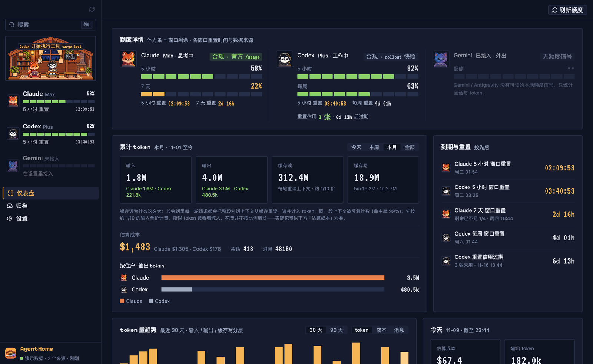
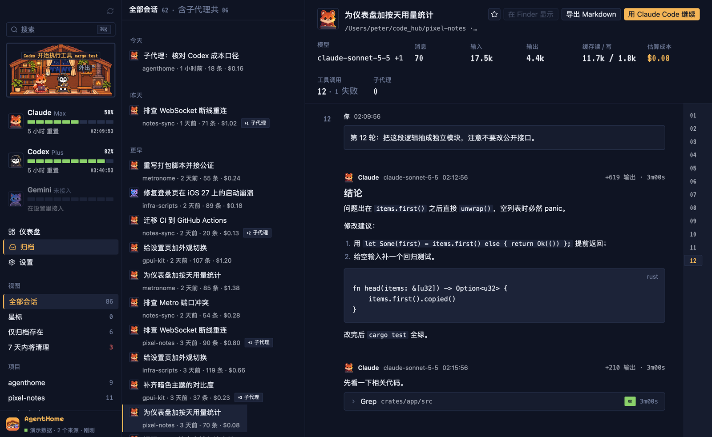
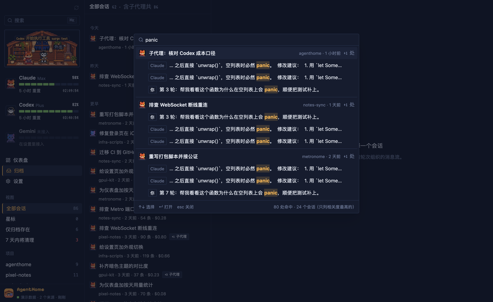

# AgentHome

[English](README.md) | 简体中文

本机 AI 编程 agent 的家。AgentHome 把 Claude Code、Codex、Gemini 的会话收进一个长期保存、可全文搜索的归档，并把 token 用量、估算成本和订阅剩余额度放在同一块仪表盘上。

Rust + [GPUI Kit](https://github.com/longbridge/gpui-kit) 编写的原生 macOS 应用，所有数据只留在本机。



> 界面目前只有简体中文，英文界面在路线图上。所有截图均为内置演示数据。

## 为什么做

- **agent 会删掉你的历史。** Claude Code 默认 30 天后清理会话转录。三个月前解决难题的那次对话，到时候就找不回来了。
- **token 账算不清。** 长会话每一轮都会把整段上下文从缓存重读一遍，token 数看起来大得吓人，却和花费对不上。不同模型、不同缓存档、不同上下文长度单价都不一样。
- **额度散落各处。** Claude 的 5 小时 / 7 天窗口、Codex 的 5 小时 / 每周窗口、Codex 重置信用及其过期时间，分在不同地方。

AgentHome 把每份转录拷进你自己的归档，建全文索引，并直接从转录里计算用量和成本。

## 功能

- **比 agent 清理活得久的归档。** 每份转录入库前先逐字节拷贝（zstd 压缩）到 `~/AgentHome/raw/`，agent 删掉自己的文件后，你的副本还在。
- **三个来源。** Claude Code、Codex（含已归档会话）、Gemini CLI。Antigravity 只索引标题、时间和工作区，消息正文是加密的，读不了。
- **实时同步。** 文件系统事件触发按字节偏移的增量入库，大会话追加一行约 0.5 毫秒；每小时一次全量扫描兜底。
- **仪表盘。** 各 agent 额度、累计 token（输入 / 输出 / 缓存读 / 缓存写）、估算成本、30 / 90 天趋势、今天、按模型与按项目、到期与重置、归档健康。
- **归档浏览。** 按日分组、子代理折叠进父会话、会话级成本；会话详情按轮次展示，工具调用是可折叠的 Trace 行，支持 Markdown 与代码高亮。
- **⌘K 全局搜索。** 跨全部消息全文搜索，支持中文子串；结果按会话分组、命中词高亮，回车直接跳到那条消息。
- **会话操作。** 在 Finder 显示原件、导出 Markdown、复制用原 agent 继续该会话的命令。
- **像素栖息地。** 左栏的像素小屋里住着 Claude（狐狸）、Codex（企鹅）、Gemini（猫），随真实活动与额度工作、思考、开心、疲惫或睡觉。
- **CLI。** 在终端里看同一份数据：`agenthome scan / sessions / show / stats / quota / activity / statusline`。

逐页面说明见 [docs/features.zh-CN.md](docs/features.zh-CN.md)。

| 会话详情 | ⌘K 搜索 |
|---|---|
|  |  |

## 安装

要求：macOS 15 及以上，Apple Silicon（arm64）。

1. 从 [最新 Release](https://github.com/PeterChen1997/agenthome/releases/latest) 下载 `AgentHome-<版本>-macos-arm64.zip`。
2. 解压，把 `AgentHome.app` 拖进「应用程序」。
3. 打开即可。应用已用 Developer ID 签名并经 Apple 公证，不会出现 Gatekeeper 拦截。

首次启动会创建 `~/AgentHome/` 并扫描能找到的来源目录，无需配置。

CLI 随应用附带，位于 `AgentHome.app/Contents/MacOS/agenthome`，可以软链到 `PATH` 里，也可以从源码构建（见下文）。

## 隐私与合规

- **对 agent 只读。** AgentHome 读取 agent 的会话目录，绝不修改、移动或软链其中任何文件。只拷贝，不链接。
- **不读凭据。** 不读 API key、OAuth token、凭据文件或 macOS 钥匙串。
- **不调私有端点。** 不调用 Claude OAuth usage 端点，也不调用 Codex 的私有用量端点。
- **无遥测、不上传。** 没有统计，没有云同步，会话数据不会离开本机。
- **额度怎么读。**
  - Claude：每 15 分钟在后台伪终端运行一次官方 `claude` CLI 的 `/usage`，读取它打印的文字。不发对话、不耗 token。需要本机装有 `claude` CLI 并已登录。
  - Codex：读 Codex 自己写进 rollout 文件的 `rate_limits` 快照。
  - Gemini：没有本地额度信号，只统计会话与 token。

归档里是你完整的对话历史，可能包含你曾粘贴给 agent 的密钥。请像对待其他敏感目录一样保护 `~/AgentHome/`。详情与漏洞报告方式见 [SECURITY.md](SECURITY.md)。

## 成本怎么算

成本是「等价 API 价」的估算，不是订阅实际扣的钱。

- 从转录里逐请求读取 token 用量，按内置的 [LiteLLM](https://github.com/BerriAI/litellm) 价表快照（2026-11-09）计价。
- 缓存读、5 分钟缓存写、1 小时缓存写分别计价；长上下文分档（如部分 OpenAI 模型超过 272k token）按单次请求判定。
- Claude 会话被 fork / resume 时会把历史消息复制进新文件，这些重复按消息 id 只计一次。
- 未知模型标为「无定价」，不按 0 计。
- 内置价表变化时，已入库的成本自动重算。

与 [ccusage](https://github.com/ryoppippi/ccusage) 对照，合计偏差约 1%。完整核对过程见 [docs/12-成本口径核对.md](docs/12-成本口径核对.md)。

## 数据布局

AgentHome 写入的所有内容都在 `~/AgentHome/` 下：

| 路径 | 内容 |
|---|---|
| `raw/<provider>/<machine>/...` | 转录的逐字节副本，zstd 压缩，附 `manifest.json`（来源路径、sha256）。只增不改：增长的文件按字节段追加，被改写的文件另存新版本。Antigravity 的加密 `.pb` 不归档。 |
| `index/agenthome.db` | SQLite 索引，含 FTS5 trigram 全文索引，可从来源重建。 |
| `signals/` | 额度快照（如 `claude-usage.json`）。 |
| `config/app.json` | 应用偏好（外观）。 |

读取的来源：

| Agent | 位置 |
|---|---|
| Claude Code | `~/.claude/projects/` |
| Codex | `~/.codex/sessions/`、`~/.codex/archived_sessions/` |
| Gemini CLI | `~/.gemini/tmp/<hash>/chats/`（`.json` / `.jsonl`） |
| Antigravity | `~/.gemini/antigravity/conversation_summaries.db`（仅标题、时间、工作区） |

存放星标与笔记的第三层（`user/`）已设计但尚未持久化，星标目前只在内存里。

注意：重建索引会重新读取 agent 当前的文件。原件已被 agent 删除的会话届时会从索引里消失；它们的字节仍在 `raw/` 里，但「从 raw 层重建索引」尚未实现。

## CLI

```text
agenthome scan        [--root DIR] [--codex-root DIR] [--gemini-root DIR] [--db PATH] [--no-raw]
agenthome sessions    [--db PATH] [--limit N] [--query TEXT] [--project NAME]
agenthome show        <会话 id 或前缀> [--db PATH]
agenthome stats       [--db PATH] [--period today|week|month|all] [--days N]
agenthome quota       [--codex-root DIR] [--statusline FILE] [--refresh-claude]
agenthome activity    [--db PATH] [--root DIR] [--codex-root DIR] [--gemini-root DIR]
agenthome statusline  status|install|uninstall [--settings FILE] [--bin-dir DIR]
```

- `scan`：增量入库全部检测到的来源，并把原件归档到 raw 层（`--no-raw` 跳过归档）。
- `sessions`：列出会话；`--query` 对标题与消息全文搜索。
- `show`：打印一个会话的消息。
- `stats`：汇总、按模型、按项目、每日的用量与成本（默认最近 30 天）。
- `quota`：打印额度快照；`--refresh-claude` 先跑一次官方 `claude /usage`（约 10 秒，不耗 token）。
- `activity`：各来源最近活动。
- `statusline`：管理旧版 Claude statusline 包装脚本。额度改走 `/usage` 后已不再需要；`uninstall` 会把 `~/.claude/settings.json` 里的 `statusLine` 还原（改前先备份）。

## 从源码构建

要求：macOS 15+、Xcode Command Line Tools、rustup。工具链（Rust 1.99.1）由 `rust-toolchain.toml` 钉版并自动安装。

```bash
git clone https://github.com/PeterChen1997/agenthome.git
cd agenthome
```

用演示数据运行（不需要本机会话）：

```bash
cargo run -p agenthome-app -- --mock
```

构建开发用 `.app` 并打开：

```bash
cargo build -p agenthome-app && ./script/bundle-dev.sh && open target/AgentHome.app
```

运行 CLI：

```bash
cargo run -p agenthome-cli --release -- scan
```

每个改动都要通过：

```bash
cargo fmt --all --check && cargo clippy --workspace --all-targets -- -D warnings && cargo test --workspace
```

离屏截图（本文档的截图就是这样生成的）：

```bash
cargo build -p agenthome-app --features capture
./target/debug/agenthome-app --mock --page dashboard --capture out.png
```

首次构建要从源码编译 GPUI，需要几分钟。仓库结构、提交约定、如何接入新来源见 [CONTRIBUTING.zh-CN.md](CONTRIBUTING.zh-CN.md)；设计与开发文档索引见 [docs/README.md](docs/README.md)。

## 路线图

- 英文界面
- Windows 与 Linux 版本
- 更多来源（如 OpenCode 等 agent CLI）
- 菜单栏弹窗：额度与今日数据
- 星标与笔记持久化；tool-results 等附属文件归档

## 许可

[Apache License 2.0](LICENSE)。第三方声明见 [NOTICE](NOTICE) 与 [THIRD_PARTY_LICENSES.md](THIRD_PARTY_LICENSES.md)。
