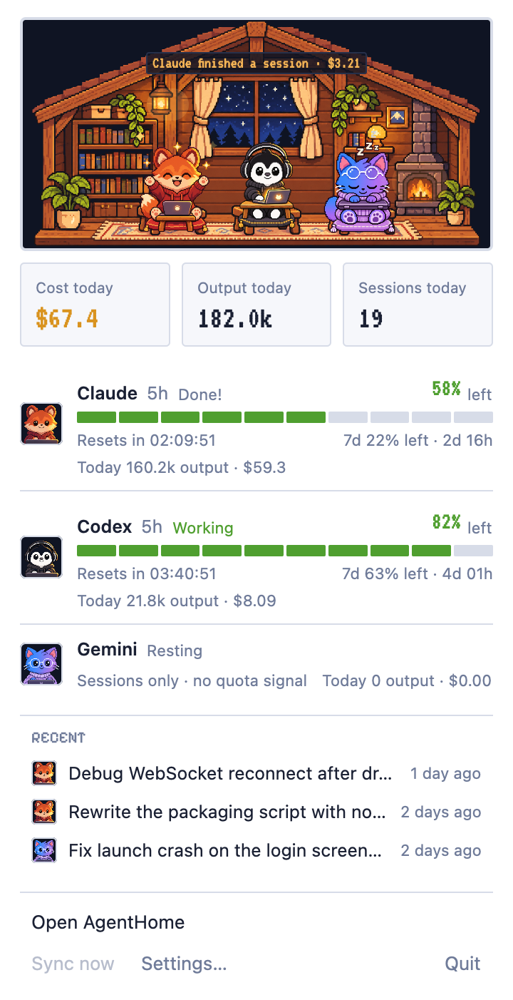
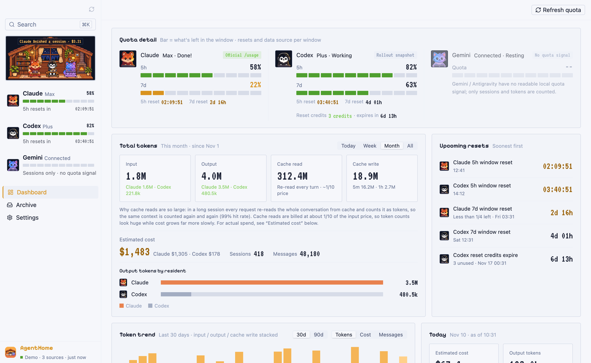
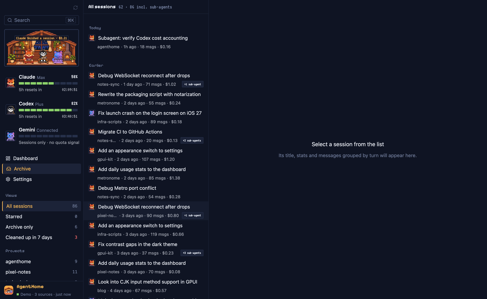
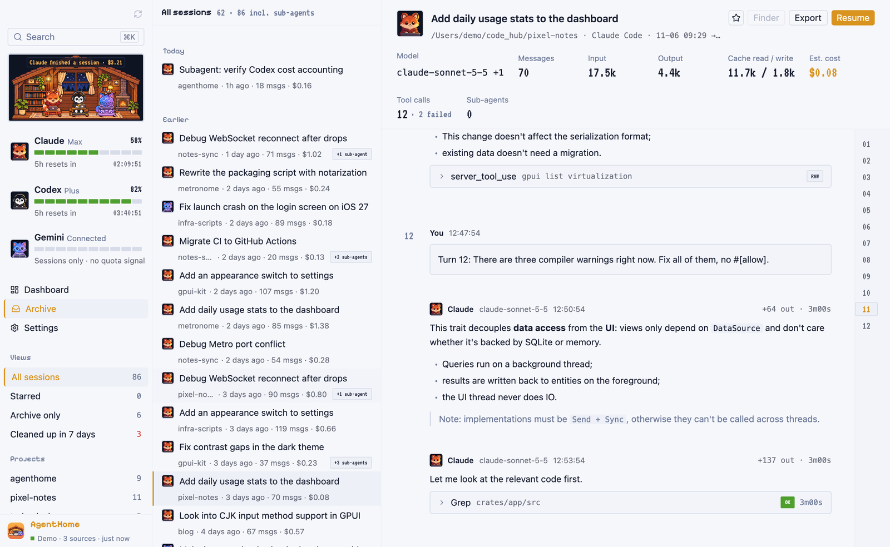
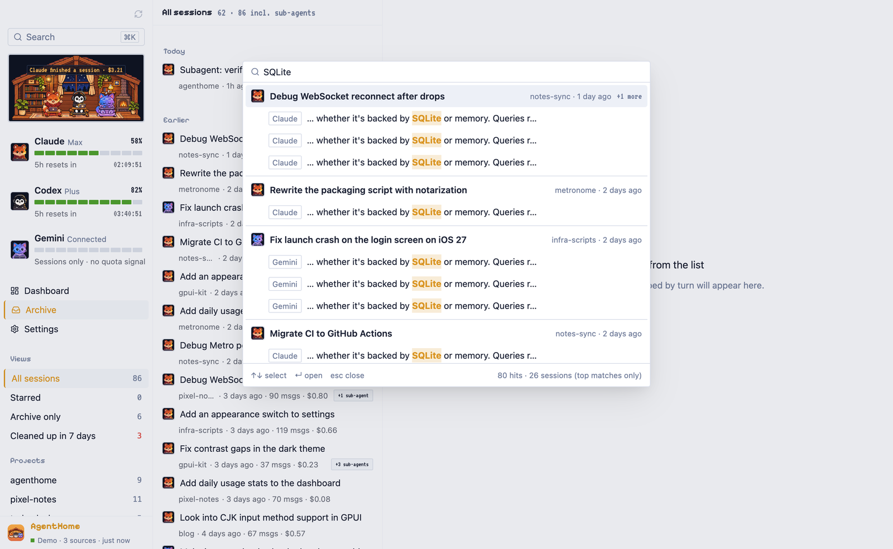
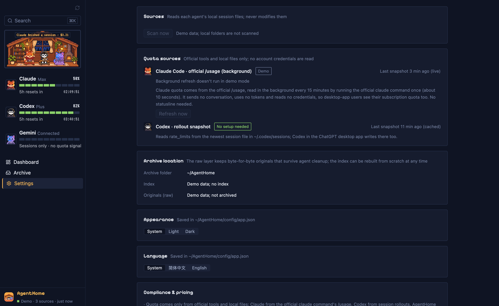

# AgentHome features

English | [简体中文](features.zh-CN.md)

A page-by-page tour of AgentHome 0.2.0. The app has a **menu bar popup** for a quick look and a main window with a fixed left sidebar and three pages: **Dashboard**, **Archive** and **Settings**. ⌘K search is available everywhere in the main window.

The interface is available in English and Simplified Chinese (see [Language](#language)). All screenshots use built-in demo data (`--mock`).

- [Menu bar](#menu-bar)
- [Sidebar](#sidebar)
- [Pixel habitat](#pixel-habitat)
- [Dashboard](#dashboard)
- [Archive](#archive)
- [Session detail](#session-detail)
- [⌘K global search](#k-global-search)
- [Settings](#settings)
- [Language](#language)
- [Sync and storage](#sync-and-storage)
- [CLI](#cli)

## Menu bar

AgentHome puts a small pixel-house icon in the macOS menu bar. Clicking it opens a usage summary under the icon; clicking anywhere else closes it.

  
  

From top to bottom:

- **Habitat**: the same pixel house as in the sidebar, with its event bubbles.
- **Today**: three tiles, **Cost today**, **Output today** and **Sessions today**.
- **One row per agent** (Claude, Codex, Gemini): status (Working, Thinking, Just finished, Low quota, Idle, Not connected), the percentage left in the 5-hour window with a 10-cell stamina bar, the countdown to its reset, the tightest other window (for example "7d 22% left · 2d 16h"), and today's output tokens and cost. Gemini has no quota signal, so its row shows sessions and today's usage only.
- **Recent**: the three most recently updated sessions (sub-agents excluded). Clicking one opens the main window on that session.
- **Buttons**: **Open AgentHome**, **Sync now** (scans all sources immediately), **Settings…** and **Quit**.

The popup keeps updating while the main window is hidden.

**Closing and quitting.** Closing the main window only hides it; AgentHome keeps running in the menu bar, syncing and reading quota. Bring the window back with **Open AgentHome** in the popup or by clicking the Dock icon. To quit, use ⌘Q, **Quit** in the popup, or the Dock menu.

Not implemented yet: a global shortcut to open the popup, an icon that changes color when quota runs low, and reminders before quota resets or credits expire.

## Sidebar

From top to bottom:

- **Sync button** (top right of the sidebar): triggers an immediate scan. The empty area at the top can be dragged to move the window.
- **Search box** (⌘K): opens the global search palette.
- **Habitat**: the pixel house, see below.
- **Resident rows**: one row per agent with its plan name, a ten-segment "stamina" bar showing how much of the current quota window remains, the percentage remaining and a countdown to the next reset. Gemini shows "Sessions only · no quota signal" because Gemini has no local quota data.
- **Navigation**: Dashboard, Archive, Settings.
- **Page-specific section**: on the Archive page, views and projects (see [Archive](#archive)).
- **Footer**: app name and sync status, for example "Synced just now · 3 sources", or ingestion progress "x/y" while a scan is running.

## Pixel habitat

A small pixel-art house at the top of the sidebar, drawn once for the whole app. Three residents live in it:

| Resident | Agent |
|---|---|
| Fox | Claude |
| Penguin | Codex |
| Cat | Gemini |

Each resident's state is derived from real activity in that agent's transcripts and from its quota:

| State | Label | When |
|---|---|---|
| Working | Working | New records appeared in the last 30 seconds. |
| Thinking | Thinking | The latest record is a thinking block or a tool call still waiting for its result, or the session has been quiet for 30 seconds to 10 minutes. |
| Happy | Done! | Shown for 3 seconds after a session finishes or quota resets from zero. |
| Tired | Low battery | Less than 20% of the quota window remains. |
| Sleeping | Resting | No activity for 10 minutes, the session ended, or the quota is exhausted and waiting for reset. |
| Away | Away | The agent's data directory was not found. A sign stands on the desk instead of the resident. |

When several conditions hold, the order is: away, sleeping (quota exhausted), tired, happy, working, thinking, sleeping (idle). The house also follows the local clock (day, evening, night; lamps and fireplace light up in the evening) and shows short event bubbles, for example when a session finishes.

## Dashboard

The **Refresh quota** button at the top right re-reads quota immediately.

### Quota detail

One column per agent: resident avatar, plan (for example Max or Plus), current habitat state, and a tag naming the data source.

- **Claude** (tag: Compliant · official /usage): 5-hour and 7-day windows with percentage remaining and countdowns to reset. Data comes from running the official `claude` CLI's `/usage` in the background every 15 minutes.
- **Codex** (tag: Compliant · rollout snapshot): 5-hour and weekly windows, plus ChatGPT **reset credits** with how many you have and when each expires. Window data comes from the `rate_limits` snapshot Codex writes into its own rollout files; reset credits are not stored locally, so you click Query in Settings (you are asked to allow it the first time) and the official codex bundled with the ChatGPT app reads them once with your signed-in account. AgentHome never reads credentials and never redeems a credit.
- **Update check**: at launch and once a day AgentHome asks GitHub for the latest release. When there is a newer one it shows a prompt once and a "New x.y.z" badge in the sidebar footer that opens the release page. Only the version number is fetched, nothing about your sessions is sent, and nothing is downloaded or installed automatically. Settings → Software update has a manual check and a switch to turn the automatic check off.
- **Gemini**: Quota comes from Antigravity CLI (`agy`): every 15 minutes AgentHome runs the official `agy -p /usage` once (no conversation, no tokens, no credentials read) and shows the 5-hour and weekly limits for the Gemini group and the Claude/GPT group, plus the separate weekly Gemini 4 Argon limit on Pro plans. The primary window is the Gemini group's 5-hour limit. Without `agy` only sessions and tokens are counted (Gemini CLI has no quota signal). The cat's usage is the sum of Gemini CLI and Antigravity CLI.

Bars are stamina bars: they show what remains in each window ("Bar = what's left in the window") and change color as it runs low. Countdowns turn amber when a reset is less than 6 hours away or less than a quarter of the window remains, and red when less than an hour is left.

### Total tokens

Period tabs: Today, Week, Month, All.

- Four tiles: **input**, **output**, **cache read**, **cache write**, each split by agent. The cache-write tile also splits 5-minute and 1-hour writes.
- A short explanation of why cache read is so large: in a long session every request re-reads the whole conversation from cache, so the same context is counted again and again (hit rates around 99% are normal). Cache reads cost roughly a tenth of the input price, which is why token counts grow much faster than cost.
- **Estimated cost** for the period, split by agent, with session and message counts. See [How costs are calculated](../README.md#how-costs-are-calculated).
- **Output tokens by resident**: a horizontal bar per agent.

### Upcoming resets

All upcoming events in time order: each quota window reset, and Codex credit expiry. Each row shows the absolute time and a countdown. Rows add context when relevant, for example "Less than 1/4 left".

### Token trend

Daily bars for the last 30 or 90 days. A toggle switches the metric between tokens (input / output / cache write stacked), cost, and message count.

### Today

Four tiles for today so far: estimated cost, output tokens, sessions, and cache read (with cache write). Each tile compares with yesterday. The card also lists how many sessions are currently in progress.

### By model and by project

Cost per model as horizontal bars, and the top 5 projects (by working directory) by cost.

### Archive health

Per source: total sessions, sessions that exist **only in the archive** because the agent already deleted the original, sessions whose originals will be **cleaned up within 7 days**, and compressed `.zst` files (Codex compresses old rollouts; AgentHome decompresses them when parsing).

## Archive

**Sidebar views**: All sessions, Starred, Archive only, Cleaned up in 7 days. Below them, **projects** with session counts. Stars are kept in memory only for now and are lost on restart.

**Session list**:

- The header shows the number of sessions and the total including sub-agents ("N incl. sub-agents"), which matches the sidebar count.
- Sessions are grouped by day (today, yesterday, earlier).
- Each row shows the agent icon, title, project, relative time, message count and estimated cost.
- Sub-agent sessions are folded under their parent; the row shows a "+N sub-agents" badge.

## Session detail

**Header**: title, working directory, source agent and time range, and actions:

- **Star** (☆).
- **Finder**: selects the original transcript file in Finder. It does not open or modify it.
- **Export**: writes the session as Markdown to `~/Downloads`.
- **Resume**: copies the command that continues the session in its agent (`claude --resume <id>` or `codex resume <id>`) to the clipboard, to paste in a terminal.

**Metrics**: model(s), messages, input, output, cache read / write, estimated cost, tool calls (with failures), sub-agents.

**Message stream**:

- Organized by turns; each turn starts with your prompt and the turn number sits on the left. A turn index on the right jumps between turns.
- Assistant messages render Markdown, lists, tables and syntax-highlighted code blocks, with the model, time, output tokens and duration.
- Thinking, tool calls and tool results are collapsed into **trace rows**: tool name, argument summary, status tag (OK / ERR) and duration. Tool calls are paired with their results.
- Opening a session scrolls to the latest message. If the session is still running, new messages are appended as they are ingested.

## ⌘K global search

Press ⌘K (or click the search box) to open the palette.

- Full-text search over all messages, backed by SQLite FTS5 with a trigram tokenizer, so Chinese substrings work.
- Results are grouped by session: title, project, relative time and number of hits. Each hit shows the speaker (you, or the agent) and a snippet with the match highlighted.
- ↑ / ↓ select, Enter opens the session and scrolls to the matching message, which is highlighted. Esc closes.
- The footer shows the total hit count and how many sessions are listed (only the most relevant are shown).

## Settings

- **Sources**: each detected source with its root directory, watch status and last scan, plus a **Scan now** button. AgentHome only reads these directories and never modifies them.
- **Quota sources**:
  - Claude Code · official /usage (background): time of the latest snapshot and a **Refresh now** button. A refresh starts the `claude` command once (about 10 seconds); it sends no conversation, uses no tokens and reads no credentials, and it works for desktop-app users too.
  - If an older AgentHome statusline wrapper script is detected in `~/.claude/settings.json`, a notice offers to **uninstall** it. Uninstalling restores your original `statusLine` setting and backs up the file first.
  - Codex · rollout snapshot: no installation needed; shows the time of the latest snapshot.
- **Archive location**: the archive directory, index size and raw-layer size.
- **Appearance**: System, Light or Dark. Saved in `~/AgentHome/config/app.json`.
- **Language**: System, 简体中文 or English. See [Language](#language).
- **Compliance & pricing**: what AgentHome does and does not access, and the version of the bundled price table (for example `litellm-2026-11-09`).

## Language

The interface, including the menu bar popup and the demo data, is available in English and Simplified Chinese. Choose it under **Settings → Language**:

- **System** (default): Chinese when the first preferred language in macOS is Chinese, English otherwise.
- **简体中文** or **English**: always use that language.

The change applies immediately, without a restart, and is saved in `~/AgentHome/config/app.json`. The launch option `--lang zh-CN|en` pins the language for one run without saving it.

Session content is shown as recorded; it is not translated. The CLI output is still in Chinese.

## Sync and storage

- On launch AgentHome creates the index if it does not exist and scans all sources.
- It then watches the source directories with FSEvents. Changes are batched (a short quiet period, at most about 10 seconds) and only changed files are processed. Append-only transcripts are parsed from the last byte offset, so only new lines are read and written.
- A full scan runs every hour as a safety net.
- Before indexing, each transcript is archived byte-for-byte into `~/AgentHome/raw/` (zstd). Growing files are stored as appended byte ranges; rewritten files are stored as a new version.
- When new data arrives the dashboard and archive refresh in place.

See [Data layout](../README.md#data-layout) for the directory structure.

## CLI

The `agenthome` command reads and writes the same index as the app. It ships inside the app bundle (`AgentHome.app/Contents/MacOS/agenthome`) and can be built with `cargo build -p agenthome-cli --release`. Output is in Chinese.

| Command | What it does | Options |
|---|---|---|
| `scan` | Ingest all detected sources incrementally and archive originals to the raw layer. | `--root`, `--codex-root`, `--gemini-root`, `--db`, `--no-raw` |
| `sessions` | List sessions. | `--db`, `--limit` (default 20), `--query` (full-text), `--project` |
| `show <id>` | Print a session's messages. Accepts a full id or a prefix. | `--db` |
| `stats` | Totals, per model, per project and per day. | `--db`, `--period today\|week\|month\|all`, `--days N` (default 30) |
| `quota` | Print quota snapshots. | `--codex-root`, `--statusline`, `--refresh-claude` (run `claude /usage` once first, about 10 s) |
| `activity` | Recent activity per source. | `--db`, `--root`, `--codex-root`, `--gemini-root` |
| `statusline status\|install\|uninstall` | Manage the legacy Claude statusline wrapper (edits `~/.claude/settings.json`, backed up first). Not needed for quota any more. | `--settings`, `--bin-dir` |

Run `agenthome <command> --help` for details.
