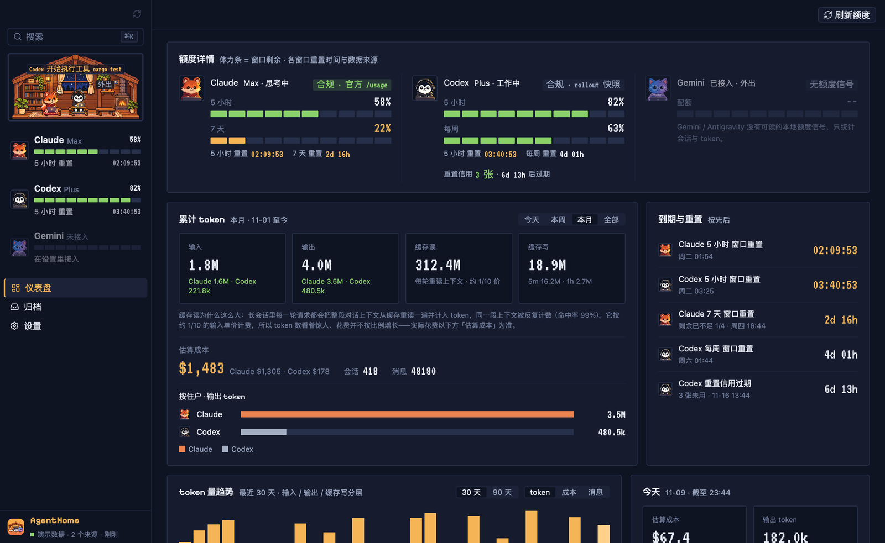
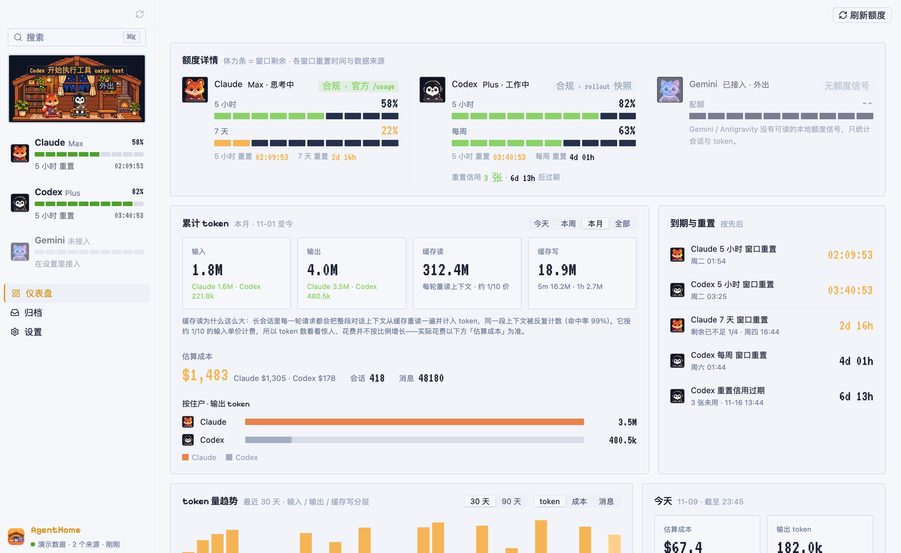
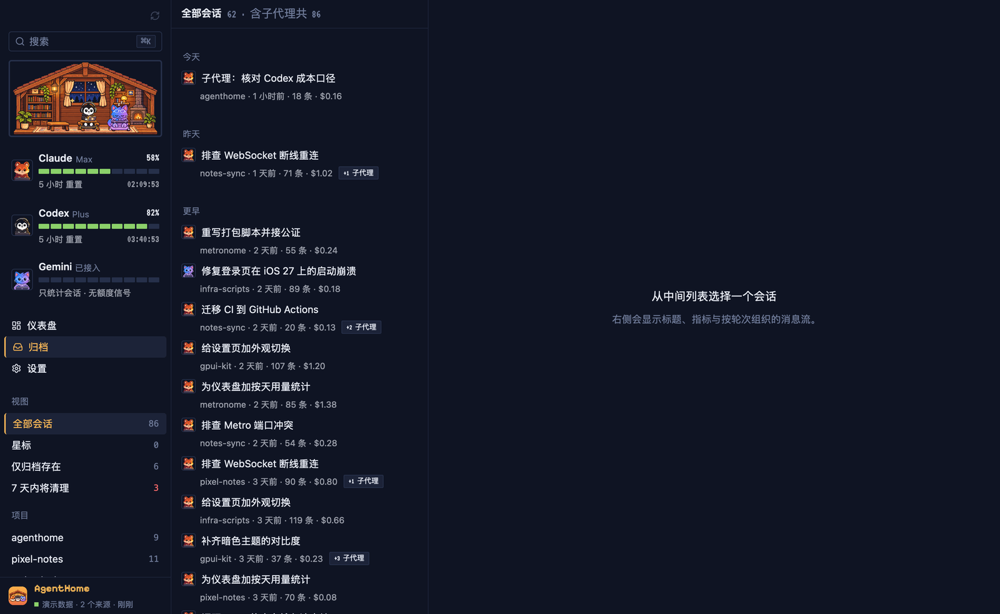
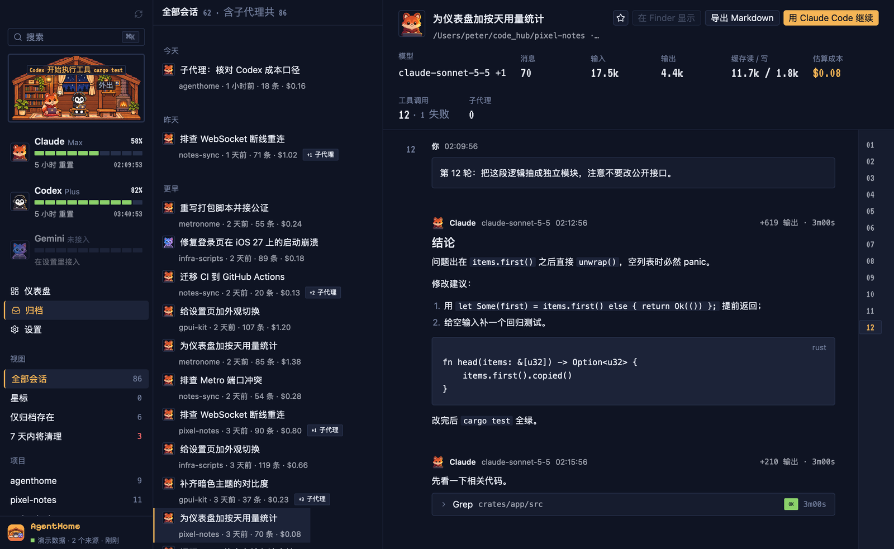
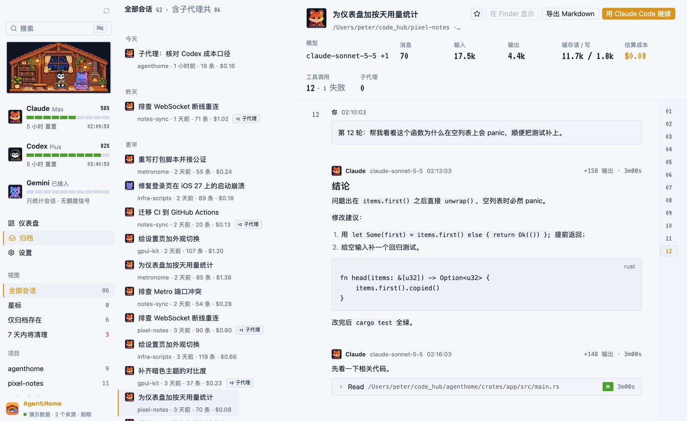
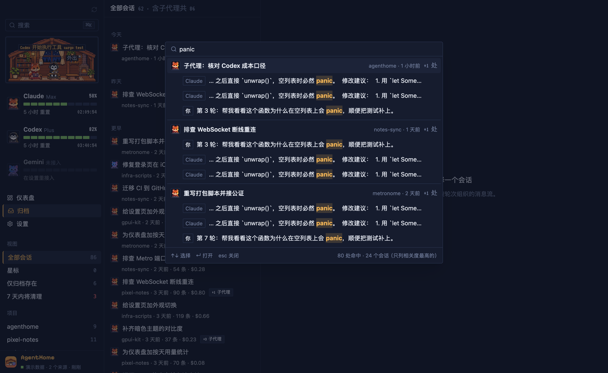
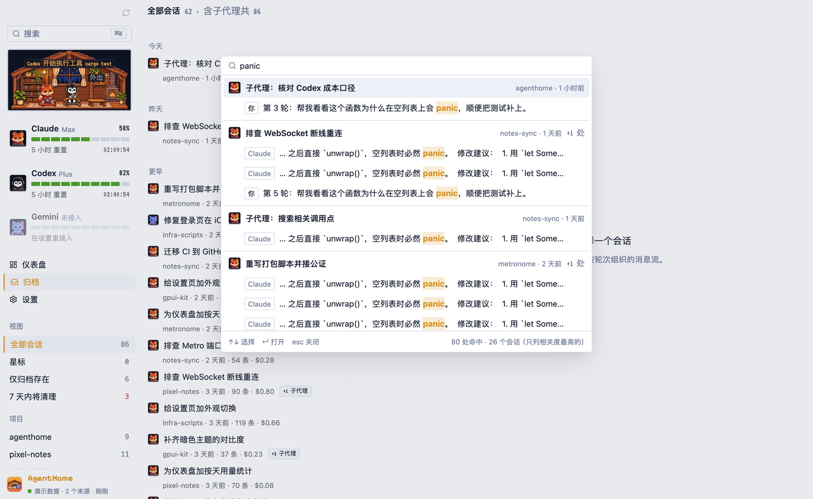
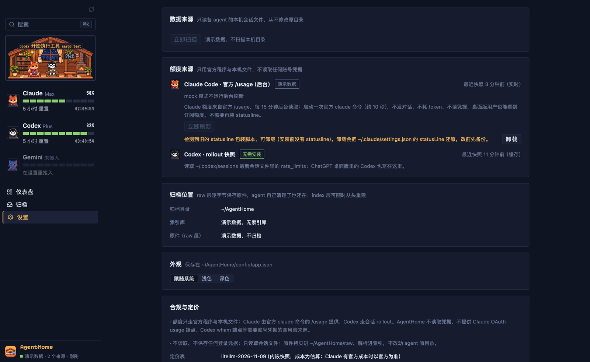

# AgentHome features

English | [简体中文](features.zh-CN.md)

A page-by-page tour of AgentHome 0.1.6. The app has one window with a fixed left sidebar and three pages: **Dashboard**, **Archive** and **Settings**. ⌘K search is available everywhere.

The interface is currently Simplified Chinese only; this document gives the English meaning of each label. All screenshots use built-in demo data (`--mock`).

- [Sidebar](#sidebar)
- [Pixel habitat](#pixel-habitat)
- [Dashboard](#dashboard)
- [Archive](#archive)
- [Session detail](#session-detail)
- [⌘K global search](#k-global-search)
- [Settings](#settings)
- [Sync and storage](#sync-and-storage)
- [CLI](#cli)

## Sidebar

From top to bottom:

- **Sync button** (top right of the sidebar): triggers an immediate scan. The empty area at the top can be dragged to move the window.
- **Search box** (搜索, ⌘K): opens the global search palette.
- **Habitat**: the pixel house, see below.
- **Resident rows**: one row per agent with its plan name, a ten-segment "stamina" bar showing how much of the current quota window remains, the percentage remaining and a countdown to the next reset. Gemini shows "connected, no quota signal" (已接入 · 无额度信号) because Gemini has no local quota data.
- **Navigation**: Dashboard (仪表盘), Archive (归档), Settings (设置).
- **Page-specific section**: on the Archive page, views and projects (see [Archive](#archive)).
- **Footer**: app name and sync status, for example "watching · N sources · synced just now", or ingestion progress "x/y" while a scan is running.

## Pixel habitat

A small pixel-art house at the top of the sidebar, drawn once for the whole app. Three residents live in it:

| Resident | Agent |
|---|---|
| Fox | Claude |
| Penguin | Codex |
| Cat | Gemini |

Each resident's state is derived from real activity in that agent's transcripts and from its quota:

| State | Label | When |
|---|---|---|
| Working | 工作中 | New records appeared in the last 30 seconds. |
| Thinking | 思考中 | The latest record is a thinking block or a tool call still waiting for its result, or the session has been quiet for 30 seconds to 10 minutes. |
| Happy | 完成了 | Shown for 3 seconds after a session finishes or quota resets from zero. |
| Tired | 快没电 | Less than 20% of the quota window remains. |
| Sleeping | 休息中 | No activity for 10 minutes, the session ended, or the quota is exhausted and waiting for reset. |
| Away | 外出 | The agent's data directory was not found. A sign stands on the desk instead of the resident. |

When several conditions hold, the order is: away, sleeping (quota exhausted), tired, happy, working, thinking, sleeping (idle). The house also follows the local clock (day, evening, night; lamps and fireplace light up in the evening) and shows short event bubbles, for example when a session finishes.

## Dashboard

The **Refresh quota** button (刷新额度) at the top right re-reads quota immediately.

### Quota detail (额度详情)

One column per agent: resident avatar, plan (for example Max or Plus), current habitat state, and a tag naming the data source.

- **Claude** (tag: compliant · official `/usage`): 5-hour and 7-day windows with percentage remaining and countdowns to reset. Data comes from running the official `claude` CLI's `/usage` in the background every 15 minutes.
- **Codex** (tag: compliant · rollout snapshot): 5-hour and weekly windows, plus **reset credits** (重置信用) with the number of credits and time until they expire. Data comes from the `rate_limits` snapshot Codex writes into its own rollout files.
- **Gemini**: no quota signal (无额度信号). Gemini CLI and Antigravity have no readable local quota data, so only sessions and tokens are counted.

Bars are stamina bars: they show what remains in each window (体力条 = 窗口剩余) and change color as it runs low. Countdowns turn amber when a reset is less than 6 hours away or less than a quarter of the window remains, and red when less than an hour is left.

### Cumulative tokens (累计 token)

Period tabs: today, this week, this month, all (今天 / 本周 / 本月 / 全部).

- Four tiles: **input**, **output**, **cache read**, **cache write**, each split by agent. The cache-write tile also splits 5-minute and 1-hour writes.
- A short explanation of why cache read is so large: in a long session every request re-reads the whole conversation from cache, so the same context is counted again and again (hit rates around 99% are normal). Cache reads cost roughly a tenth of the input price, which is why token counts grow much faster than cost.
- **Estimated cost** (估算成本) for the period, split by agent, with session and message counts. See [How costs are calculated](../README.md#how-costs-are-calculated).
- **Output tokens by resident**: a horizontal bar per agent.

### Upcoming resets (到期与重置)

All upcoming events in time order: each quota window reset, and Codex credit expiry. Each row shows the absolute time and a countdown. Rows add context when relevant, for example "less than 1/4 remaining".

### Token trend (token 量趋势)

Daily bars for the last 30 or 90 days. A toggle switches the metric between tokens (input / output / cache write stacked), cost, and message count.

### Today (今天)

Four tiles for today so far: estimated cost, output tokens, sessions, and cache read (with cache write). Each tile compares with yesterday. The card also lists how many sessions are currently in progress.

### By model (按模型) and by project (按项目)

Cost per model as horizontal bars, and the top 5 projects (by working directory) by cost.

### Archive health (归档健康)

Per source: total sessions, sessions that exist **only in the archive** because the agent already deleted the original (仅归档存在), sessions whose originals will be **cleaned up within 7 days** (7 天内将被清理), and compressed `.zst` files (Codex compresses old rollouts; AgentHome decompresses them when parsing).

## Archive

**Sidebar views**: all sessions (全部会话), starred (星标), archive-only (仅归档存在), cleaned up within 7 days (7 天内将清理). Below them, **projects** with session counts. Stars are kept in memory only for now and are lost on restart.

**Session list**:

- The header shows the number of sessions and the total including sub-agents (含子代理共 N), which matches the sidebar count.
- Sessions are grouped by day (today, yesterday, earlier).
- Each row shows the agent icon, title, project, relative time, message count and estimated cost.
- Sub-agent sessions are folded under their parent; the row shows a "+N sub-agents" badge.

## Session detail

**Header**: title, working directory, and actions:

- **Star** (☆).
- **Reveal in Finder** (在 Finder 显示): selects the original transcript file in Finder. It does not open or modify it.
- **Export Markdown** (导出 Markdown): writes the session as Markdown to `~/Downloads`.
- **Continue in Claude Code / Codex** (用 … 继续): copies the resume command (`claude --resume <id>` or `codex resume <id>`) to the clipboard, to paste in a terminal.

**Metrics**: model(s), messages, input, output, cache read / write, estimated cost, tool calls (with failures), sub-agents.

**Message stream**:

- Organized by turns; each turn starts with your prompt and the turn number sits on the left. A turn index on the right jumps between turns.
- Assistant messages render Markdown, lists, tables and syntax-highlighted code blocks, with the model, time, output tokens and duration.
- Thinking, tool calls and tool results are collapsed into **trace rows**: tool name, argument summary, status tag (OK / ERR) and duration. Tool calls are paired with their results.
- Opening a session scrolls to the latest message. If the session is still running, new messages are appended as they are ingested.

## ⌘K global search

Press ⌘K (or click the search box) to open the palette.

- Full-text search over all messages, backed by SQLite FTS5 with a trigram tokenizer, so Chinese substrings work.
- Results are grouped by session: title, project, relative time and number of hits. Each hit shows the speaker (you, or the agent) and a snippet with the match highlighted.
- ↑ / ↓ select, Enter opens the session and scrolls to the matching message, which is highlighted. Esc closes.
- The footer shows the total hit count and how many sessions are listed (only the most relevant are shown).

## Settings

- **Data sources** (数据来源): each detected source with its root directory, watch status and last scan, plus a **Scan now** button. AgentHome only reads these directories and never modifies them.
- **Quota sources** (额度来源):
  - Claude Code · official `/usage` (background): time of the latest snapshot and a **Refresh now** button. A refresh starts the `claude` command once (about 10 seconds); it sends no conversation, uses no tokens and reads no credentials, and it works for desktop-app users too.
  - If an older AgentHome statusline wrapper script is detected in `~/.claude/settings.json`, a notice offers to **uninstall** it. Uninstalling restores your original `statusLine` setting and backs up the file first.
  - Codex · rollout snapshot: no installation needed; shows the time of the latest snapshot.
- **Archive location** (归档位置): the archive directory, index size and raw-layer size.
- **Appearance** (外观): follow system, light or dark. Saved in `~/AgentHome/config/app.json`.
- **Compliance and pricing** (合规与定价): what AgentHome does and does not access, and the version of the bundled price table (for example `litellm-2026-11-09`).

## Sync and storage

- On launch AgentHome creates the index if it does not exist and scans all sources.
- It then watches the source directories with FSEvents. Changes are batched (a short quiet period, at most about 10 seconds) and only changed files are processed. Append-only transcripts are parsed from the last byte offset, so only new lines are read and written.
- A full scan runs every hour as a safety net.
- Before indexing, each transcript is archived byte-for-byte into `~/AgentHome/raw/` (zstd). Growing files are stored as appended byte ranges; rewritten files are stored as a new version.
- When new data arrives the dashboard and archive refresh in place.

See [Data layout](../README.md#data-layout) for the directory structure.

## CLI

The `agenthome` command reads and writes the same index as the app. It ships inside the app bundle (`AgentHome.app/Contents/MacOS/agenthome`) and can be built with `cargo build -p agenthome-cli --release`. Output is in Chinese.

| Command | What it does | Options |
|---|---|---|
| `scan` | Ingest all detected sources incrementally and archive originals to the raw layer. | `--root`, `--codex-root`, `--gemini-root`, `--db`, `--no-raw` |
| `sessions` | List sessions. | `--db`, `--limit` (default 20), `--query` (full-text), `--project` |
| `show <id>` | Print a session's messages. Accepts a full id or a prefix. | `--db` |
| `stats` | Totals, per model, per project and per day. | `--db`, `--period today\|week\|month\|all`, `--days N` (default 30) |
| `quota` | Print quota snapshots. | `--codex-root`, `--statusline`, `--refresh-claude` (run `claude /usage` once first, about 10 s) |
| `activity` | Recent activity per source. | `--db`, `--root`, `--codex-root`, `--gemini-root` |
| `statusline status\|install\|uninstall` | Manage the legacy Claude statusline wrapper (edits `~/.claude/settings.json`, backed up first). Not needed for quota any more. | `--settings`, `--bin-dir` |

Run `agenthome <command> --help` for details.
