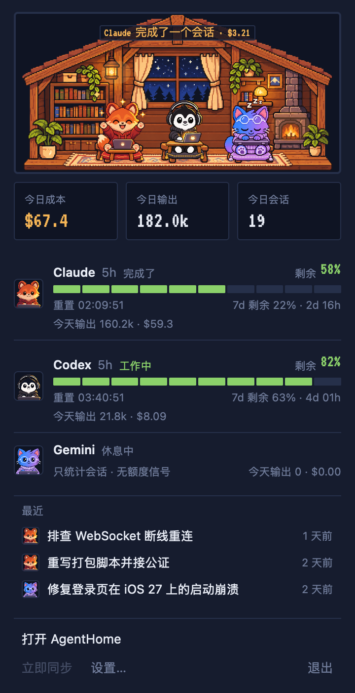
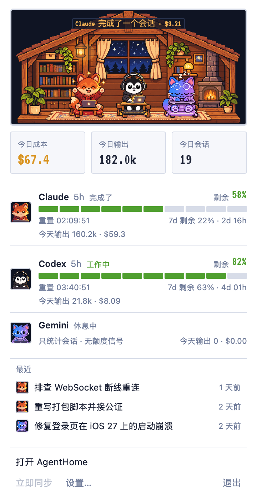
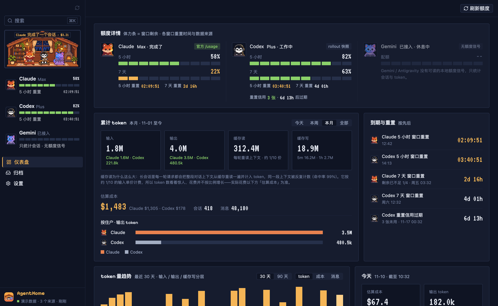
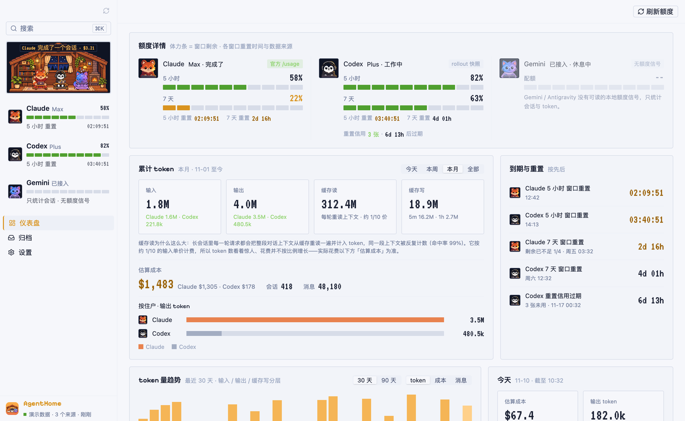
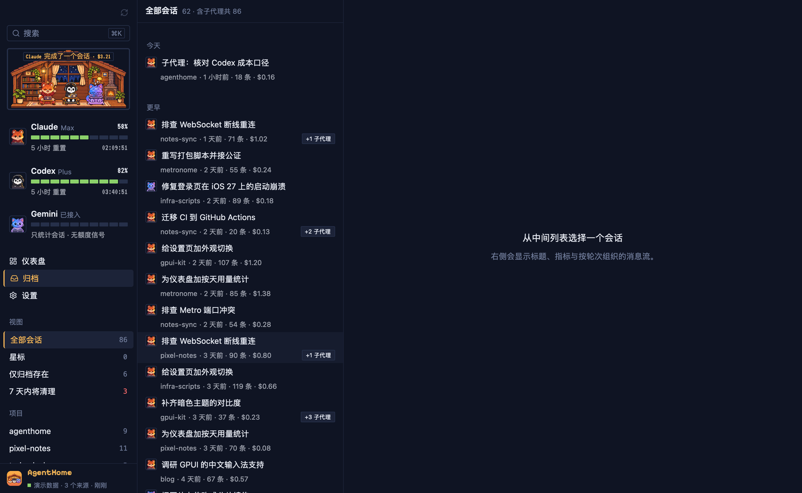
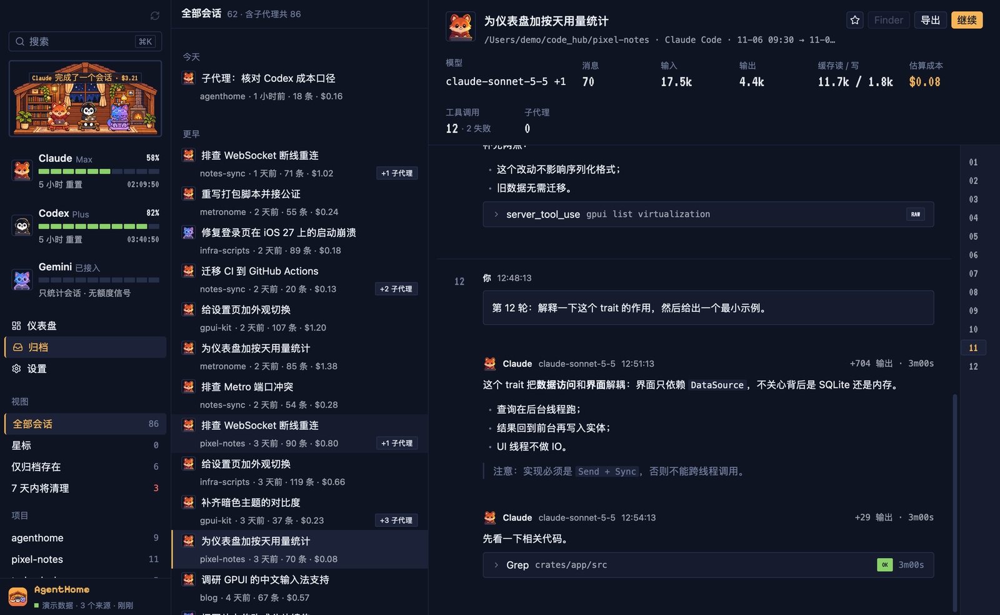
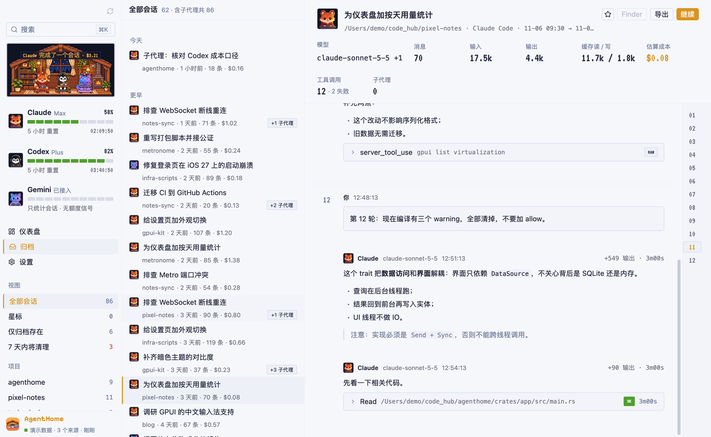
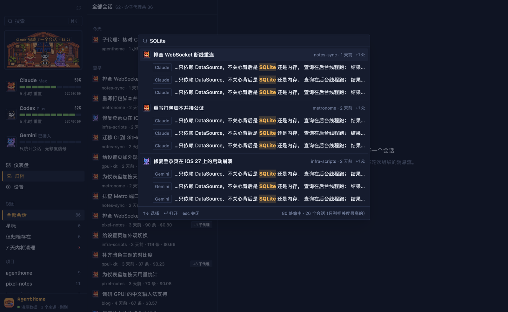
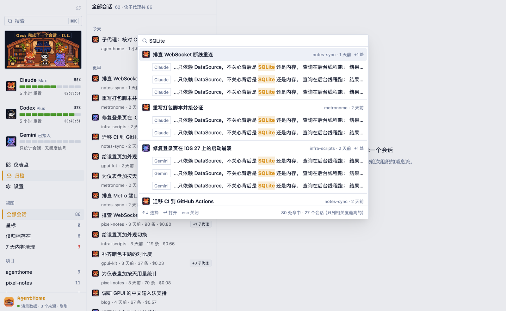
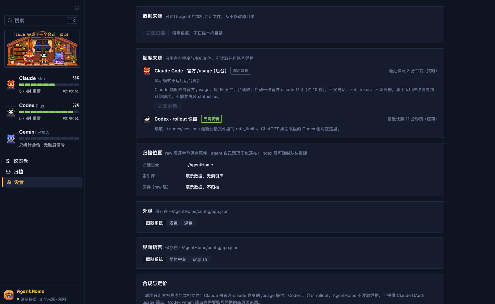

# AgentHome 功能说明

[English](features.md) | 简体中文

逐页面介绍 AgentHome 0.2.0。应用由两部分组成：随手一看的**菜单栏弹窗**，和一个主窗口——左侧固定栏 + 三个页面（**仪表盘**、**归档**、**设置**），主窗口里任何页面都可以按 ⌘K 搜索。

界面支持简体中文与英文（见[界面语言](#界面语言)）。所有截图均为内置演示数据（`--mock`）。

- [菜单栏](#菜单栏)
- [左栏](#左栏)
- [像素栖息地](#像素栖息地)
- [仪表盘](#仪表盘)
- [归档](#归档)
- [会话详情](#会话详情)
- [⌘K 全局搜索](#k-全局搜索)
- [设置](#设置)
- [界面语言](#界面语言)
- [同步与存储](#同步与存储)
- [CLI](#cli)

## 菜单栏

AgentHome 在 macOS 菜单栏放一个像素小屋图标。点击后在图标下方弹出使用概要，点别处即关闭。

  
  

从上到下：

- **栖息地**：与左栏同一座像素小屋，事件气泡也会出现在这里。
- **今日**：三个格子，**今日成本**、**今日输出**、**今日会话**。
- **每个 agent 一行**（Claude、Codex、Gemini）：状态（工作中、思考中、刚完成、额度告急、空闲、未接入）、5 小时窗口剩余百分比与 10 格体力条、距重置的倒计时、最吃紧的另一个窗口（例如「7d 剩余 22% · 2d 16h」），以及今天的输出 token 与成本。Gemini 没有额度信号，这一行只显示会话与今日用量。
- **最近**：最近更新的 3 个会话（不含子代理）。点击打开主窗口并定位到该会话。
- **按钮**：**打开 AgentHome**、**立即同步**（立即扫描全部来源）、**设置…**、**退出**。

主窗口隐藏时，弹窗照常更新。

**关窗与退出。** 关闭主窗口只是把它隐藏，AgentHome 继续在菜单栏里运行、同步并读取额度。点弹窗里的「打开 AgentHome」或点 Dock 图标可以唤回主窗口。退出用 ⌘Q、弹窗里的「退出」或 Dock 菜单。

尚未实现：呼出弹窗的全局快捷键、额度紧张时图标变色、额度重置 / 信用过期前的提醒。

## 左栏

从上到下：

- **同步按钮**（左栏右上角）：立即扫描一次。顶部空白处可以拖动窗口。
- **搜索框**（⌘K）：打开全局搜索浮层。
- **栖息地**：像素小屋，见下节。
- **住户行**：每个 agent 一行，显示套餐名、10 格体力条（当前额度窗口还剩多少）、剩余百分比和距下次重置的倒计时。Gemini 显示「只统计会话 · 无额度信号」，因为 Gemini 没有本地额度数据。
- **导航**：仪表盘、归档、设置。
- **页面专属区**：归档页在这里显示视图与项目（见[归档](#归档)）。
- **底部**：应用名与同步状态，例如「监听中 · 3 个来源 · 刚刚同步」，扫描进行中时显示「正在入库 x/y」。

## 像素栖息地

左栏顶部的像素小屋，全应用只画这一份，里面住着三位住户：

| 住户 | Agent |
|---|---|
| 狐狸 | Claude |
| 企鹅 | Codex |
| 猫 | Gemini |

每位住户的状态由该 agent 转录里的真实活动和额度推出：

| 状态 | 标签 | 什么时候 |
|---|---|---|
| 工作 | 工作中 | 最近 30 秒内有新记录。 |
| 思考 | 思考中 | 最近一条记录是思考块，或工具调用已发出、结果未回；或会话已安静 30 秒到 10 分钟。 |
| 开心 | 完成了 | 会话结束、或额度从 0 重置回来后，持续 3 秒。 |
| 疲惫 | 快没电 | 额度窗口剩余不足 20%。 |
| 睡觉 | 休息中 | 10 分钟无活动、会话已结束，或额度用完等待重置。 |
| 外出 | 外出 | 没找到该 agent 的数据目录，桌上立「外出」牌，不显示住户。 |

同时满足多个条件时，优先级为：外出 > 睡觉（额度用完）> 疲惫 > 开心 > 工作 > 思考 > 睡觉（空闲）。小屋还跟随本机时钟切换白天 / 傍晚 / 夜晚（傍晚后点灯、生火），并在会话完成等事件时冒出短气泡。

## 仪表盘

右上角「刷新额度」立即重新读取额度。

### 额度详情

每个 agent 一栏：住户头像、套餐（如 Max、Plus）、当前栖息地状态，以及标明数据来源的标签。

- **Claude**（标签「合规 · 官方 /usage」）：5 小时与 7 天窗口的剩余百分比和重置倒计时。数据来自后台每 15 分钟运行一次官方 `claude` CLI 的 `/usage`。
- **Codex**（标签「合规 · rollout 快照」）：5 小时与每周窗口，以及 ChatGPT **重置额度**的张数和每张的过期时间。窗口数据来自 Codex 自己写进 rollout 文件的 `rate_limits` 快照；重置额度本机没有，要在设置页手动点「查询」（第一次会请你授权），由 ChatGPT 桌面版自带的官方 codex 用你已登录的账号只读查一次，AgentHome 不读凭据、不兑换。
- **检查更新**：启动时与每天一次到 GitHub 查最新正式版，有新版本时弹一次提醒、左栏底部显示「更新到 x.y.z」。点「立即更新」：从 GitHub 下载安装包，核对 sha256、签名、开发者团队与苹果公证，通过后应用退出、替换自身并自动重新打开（旧版留在 `~/AgentHome/backup/`）；没法替换自身时退回「前往下载」。不点就不下载。设置 → 软件更新可手动检查或关闭自动检查。
- **Gemini**：额度来自 Antigravity CLI（`agy`）：后台每 15 分钟运行一次官方 `agy -p /usage`（不建对话、不耗 token、不读凭据），显示 Gemini 组与 Claude/GPT 组各自的 5 小时与每周额度，以及 Pro 套餐单独的 Gemini 4 Argon 周额度；主窗口是 Gemini 组的 5 小时。没装 `agy` 时只统计会话与 token（Gemini CLI 没有额度信号）。猫住户的用量是 Gemini CLI 与 Antigravity CLI 两个来源之和。

体力条表示窗口剩余（「体力条 = 窗口剩余」），快用完时变色。倒计时在距重置不足 6 小时或窗口剩余不足 1/4 时变琥珀色，不足 1 小时变红。

### 累计 token

周期切换：今天 / 本周 / 本月 / 全部。

- 四个格子：**输入**、**输出**、**缓存读**、**缓存写**，各自按 agent 拆分；缓存写另拆 5 分钟与 1 小时两档。
- 一段说明「缓存读为什么这么大」：长会话里每一轮请求都会把整段对话从缓存重读一遍，同一段上下文被反复计数（命中率 99% 左右很常见）。缓存读单价约为输入的 1/10，所以 token 数涨得远比花费快。
- **估算成本**：本周期的成本，按 agent 拆分，附会话数与消息数。算法见 [成本怎么算](../README.zh-CN.md#成本怎么算)。
- **按住户 · 输出 token**：每个 agent 一根横条。

### 到期与重置

按时间先后列出即将发生的事件：各额度窗口重置、Codex 重置额度过期（每张一行，3 天内变琥珀、1 天内变红）。每行有具体时间和倒计时，必要时附说明，例如「剩余已不足 1/4」。

### token 量趋势

最近 30 或 90 天的每日柱状图，可切换指标：token（输入 / 输出 / 缓存写分层）、成本、消息数。

### 今天

今天截至目前的四个格子：估算成本、输出 token、会话数、缓存读（附缓存写），每格与昨日对比；并显示当前有几个会话正在进行。

### 按模型、按项目

按模型的成本横条；按项目（工作目录）只取成本前 5。

### 归档健康

每个来源一组：会话总数、**仅归档存在**（原件已被 agent 清理）、**7 天内将被清理**、已压缩 `.zst` 的文件数（Codex 会压缩旧 rollout，AgentHome 解析时自动解压）。

## 归档

**左栏视图**：全部会话、星标、仅归档存在、7 天内将清理；下面是**项目**列表与各自会话数。星标目前只在内存里，重启后丢失。

**会话列表**：

- 页头显示会话数与「含子代理共 N」，与左栏计数一致。
- 按日分组（今天、昨天、更早）。
- 每行：agent 图标、标题、项目、相对时间、消息数、估算成本。
- 子代理会话折叠进父会话，行尾显示「+N 子代理」标记。

## 会话详情

**头部**：标题、工作目录、来源 agent 与起止时间，以及操作按钮：

- **星标**（☆）。
- **Finder**：在 Finder 里选中原始转录文件，不打开也不修改。
- **导出**：把会话导出为 Markdown，存到 `~/Downloads`。
- **继续**：把在 Claude Code / Codex 里续接会话的命令（`claude --resume <id>` 或 `codex resume <id>`）复制到剪贴板，粘到终端里运行。

**指标**：模型、消息数、输入、输出、缓存读 / 写、估算成本、工具调用（含失败数）、子代理数。

**消息流**：

- 按轮次组织，每轮以你的提示开头，左侧是轮次号；右侧轮次导航条可在轮次间跳转。
- 助手消息渲染 Markdown、列表、表格与代码高亮，并显示模型、时间、输出 token 与耗时。
- 思考、工具调用、工具结果折叠成 **Trace 行**：工具名、参数摘要、状态标签（OK / ERR）、耗时；工具调用与结果配对。
- 打开会话即停在最新一条；会话仍在进行时，新消息入库后会追加进来。

## ⌘K 全局搜索

按 ⌘K（或点搜索框）打开浮层。

- 对全部消息全文搜索，基于 SQLite FTS5 trigram 分词，中文子串也能搜到。
- 结果按会话分组：标题、项目、相对时间、命中处数；每条命中标明说话方（你或 agent），片段里命中词高亮。
- ↑ / ↓ 选择，回车打开会话并滚动到命中的那条消息、高亮显示；Esc 关闭。
- 底部显示总命中数与列出的会话数（只列相关度最高的）。

## 设置

- **数据来源**：每个检测到的来源的根目录、监听状态与最近扫描时间，以及「立即扫描」按钮。AgentHome 只读这些目录，从不修改。
- **额度来源**：
  - Claude Code · 官方 /usage（后台）：最近快照时间与「立即刷新」按钮。刷新会启动一次 `claude` 命令（约 10 秒），不发对话、不耗 token、不读凭据，只用桌面版的用户也能看到额度。
  - 如果在 `~/.claude/settings.json` 里检测到旧版 AgentHome statusline 包装脚本，会提示可一键**卸载**：还原原来的 `statusLine` 设置，改前先备份。
  - Codex · rollout 快照：无需安装，显示最近快照时间。
- **归档位置**：归档目录、索引库体积、raw 层体积。
- **外观**：跟随系统 / 浅色 / 深色，保存在 `~/AgentHome/config/app.json`。
- **界面语言**：跟随系统 / 简体中文 / English，见[界面语言](#界面语言)。
- **合规与定价**：AgentHome 读什么、不读什么，以及内置价表版本（如 `litellm-2026-11-09`）。

## 界面语言

界面（包括菜单栏弹窗和演示数据）支持简体中文与英文，在**设置 → 界面语言**里选择：

- **跟随系统**（默认）：macOS 首选语言的第一项是中文时用中文，否则用英文。
- **简体中文** 或 **English**：固定使用该语言。

切换立即生效，不用重启，选择保存在 `~/AgentHome/config/app.json`。启动参数 `--lang zh-CN|en` 只在本次运行固定语言，不写入偏好。

会话内容按原样显示，不做翻译。CLI 输出目前仍是中文。

## 同步与存储

- 启动时如果索引库不存在就自动建库，并扫描全部来源。
- 之后用 FSEvents 监听来源目录：变化先合并一小段时间（最长约 10 秒），只处理变化的文件；只追加的转录从上次的字节偏移继续解析，只读写新增的几行。
- 每小时一次全量扫描兜底。
- 每份转录入索引前先逐字节归档到 `~/AgentHome/raw/`（zstd）：增长的文件按字节段追加，被改写的文件另存新版本。
- 新数据入库后，仪表盘与归档原地刷新。

目录结构见 [数据布局](../README.zh-CN.md#数据布局)。

## CLI

`agenthome` 命令与应用读写同一个索引库。它随应用附带（`AgentHome.app/Contents/MacOS/agenthome`），也可以用 `cargo build -p agenthome-cli --release` 构建。

| 命令 | 作用 | 参数 |
|---|---|---|
| `scan` | 增量入库全部检测到的来源，并把原件归档到 raw 层。 | `--root`、`--codex-root`、`--gemini-root`、`--db`、`--no-raw` |
| `sessions` | 列出会话。 | `--db`、`--limit`（默认 20）、`--query`（全文搜索）、`--project` |
| `show <id>` | 打印一个会话的消息，支持完整 id 或前缀。 | `--db` |
| `stats` | 汇总、按模型、按项目、每日。 | `--db`、`--period today\|week\|month\|all`、`--days N`（默认 30） |
| `quota` | 打印额度快照。 | `--codex-root`、`--statusline`、`--refresh-claude`（先跑一次 `claude /usage`，约 10 秒） |
| `activity` | 各来源最近活动。 | `--db`、`--root`、`--codex-root`、`--gemini-root` |
| `statusline status\|install\|uninstall` | 管理旧版 Claude statusline 包装脚本（修改 `~/.claude/settings.json`，改前备份），额度已不再依赖它。 | `--settings`、`--bin-dir` |

`agenthome <命令> --help` 查看详细说明。
